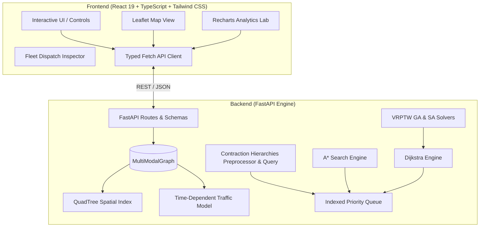

# ⚡ RouteForge: Multi-Modal Route & Logistics Optimizer

[](https://github.com/your-org/routeforge/actions)
[](LICENSE)
[](https://www.python.org/)
[](https://react.dev/)
[](https://www.typescriptlang.org/)
[](https://vitejs.dev/)

**RouteForge** is a production-grade full-stack web application and algorithmic logistics engine that goes beyond textbook shortest-path routing. It solves real-world fleet delivery and multi-modal logistics problems under **time-dependent congestion**, **vehicle capacity limits**, and **delivery time windows (VRPTW)**.

---

## 🌟 Key Capabilities

1. **Spatial & Graph Engine:**
   - **Custom 2D Quadtree Index:** Branch-and-bound $k$-nearest neighbor search and spatial bounding-box viewport queries.
   - **Binary Indexed Priority Queue:** Custom min-heap with $O(\log N)$ `decrease_key` and $O(1)$ membership lookups, powering Dijkstra, A*, and Contraction Hierarchies.
   - **Multi-Modal Street Network:** Edge traversability profiles for **Passenger Cars**, **Commercial Delivery Vans**, **Cargo Bicycles**, and **Couriers On Foot**.
   - **Continuous Time-Dependent Traffic Model:** 24-hour Gaussian traffic congestion curves capturing morning rush (07:30–09:30, up to $2.4\times$ delay), evening rush (16:30–19:00), and midday flows across road classifications (motorway, arterial, residential, pedestrian).

2. **Shortest Path & Routing Algorithms:**
   - **Dijkstra's Algorithm:** Baseline single-source shortest path using the custom Indexed Priority Queue with dynamic edge travel times.
   - **A\* Search:** Goal-directed search utilizing an admissible and consistent time-aware lower-bound heuristic:
     $$h(u, \text{target}) = \frac{\text{haversine}(u, \text{target})}{\max(\text{speed}_{\text{mode}})}$$
   - **Contraction Hierarchies (CH):**
     - **Preprocessing:** Heuristic node ordering (edge difference + contracted neighbor counts) and local Dijkstra witness searches to contract nodes and insert shortcut edges.
     - **Query:** Bidirectional upward Dijkstra search achieving $10\times$ to $50\times$ query speedups over standard Dijkstra.
     - **Path Unpacking:** Recursive shortcut expansion reconstructing the exact sequence of road segments and coordinates.

3. **Multi-Vehicle VRPTW Optimizer:**
   - Solves the **Vehicle Routing Problem with Time Windows (VRPTW)** with vehicle capacity limits, customer demands, service durations, `[earliest, latest]` delivery time windows, and late penalty penalties.
   - **Genetic Algorithm (GA):** Order Crossover (OX) adapted for multi-route partitioning, intra-route 2-Opt inversions, inter-route customer relocate and swap mutations, and elitism.
   - **Simulated Annealing (SA):** Geometric cooling schedule, Metropolis acceptance criterion, and multi-neighborhood operators (2-Opt, customer shift, route merge/rebalance).

4. **Benchmarking & Analytics Lab:**
   - Live automated benchmark comparing **Dijkstra vs. A\* vs. Contraction Hierarchies** (latency in milliseconds, nodes settled, edges relaxed, speedup factors).
   - Side-by-side **VRPTW convergence curves** (computation time vs. objective cost, constraint violations, and active fleet utilization).

5. **Interactive UI & Dispatch Inspector:**
   - Dark-themed **Leaflet map** rendering real street segments with live traffic congestion coloring (free-flow green, moderate amber, gridlock red).
   - Per-vehicle dispatch cards showing stop arrival ETAs, waiting durations, service times, load progression bars, and on-time compliance tags.

---

## 🏛️ System Architecture



---

## 📁 Repository Structure

```text
routeforge/
├── .github/
│   └── workflows/
│       └── ci.yml               # GitHub Actions CI (backend tests & frontend build)
├── backend/
│   ├── app/
│   │   ├── algorithms/
│   │   │   ├── astar.py         # Time-aware A* search with Haversine heuristic
│   │   │   ├── ch.py            # Contraction Hierarchies (contraction + query + unpacking)
│   │   │   ├── dijkstra.py      # Time-dependent Dijkstra with Indexed Priority Queue
│   │   │   ├── heuristics.py    # Admissible lower-bound spatial heuristics
│   │   │   ├── vrptw_ga.py      # Genetic Algorithm VRPTW solver
│   │   │   ├── vrptw_models.py  # Delivery stops, depot, simulation evaluator
│   │   │   └── vrptw_sa.py      # Simulated Annealing VRPTW solver
│   │   ├── api/
│   │   │   ├── routes.py        # Endpoints: routes, scenarios, benchmarks, VRPTW
│   │   │   └── schemas.py       # Pydantic request & response schemas
│   │   ├── core/
│   │   │   ├── graph.py         # Multi-modal directed graph
│   │   │   ├── priority_queue.py# Custom Indexed Priority Queue (min-heap)
│   │   │   ├── spatial_index.py # 2D Quadtree with branch-and-bound nearest neighbor
│   │   │   └── time_dependent.py# Continuous 24h traffic congestion model
│   │   ├── data/
│   │   │   ├── osm_loader.py    # Overpass API / JSON OSM graph loader
│   │   │   └── preset_cities.py # San Francisco, Manhattan, and London presets
│   │   └── main.py              # FastAPI application entrypoint & CORS config
│   ├── tests/
│   │   ├── test_api.py          # API route integration tests
│   │   ├── test_graph.py        # Graph & traffic congestion tests
│   │   ├── test_priority_queue.py # Min-heap invariants & decrease_key tests
│   │   ├── test_routing.py      # Dijkstra vs A* vs CH equivalence & speedup tests
│   │   ├── test_spatial_index.py# QuadTree k-NN and bounding-box tests
│   │   └── test_vrptw.py        # Capacity & time window feasibility tests
│   ├── Dockerfile
│   └── requirements.txt
├── frontend/
│   ├── src/
│   │   ├── components/
│   │   │   ├── Analytics/       # Benchmark Lab & Recharts modal
│   │   │   ├── Controls/        # Header, RoutingControls, FleetControls
│   │   │   ├── Dispatch/        # Per-vehicle dispatch schedule inspector
│   │   │   └── Map/             # Leaflet interactive map with congestion layers
│   │   ├── services/
│   │   │   └── api.ts           # Typed API service wrappers
│   │   ├── types/
│   │   │   └── index.ts         # TypeScript models
│   │   ├── App.tsx
│   │   ├── index.css
│   │   └── main.tsx
│   ├── Dockerfile
│   ├── package.json
│   ├── tsconfig.json
│   └── vite.config.ts
├── docker-compose.yml
├── .env.example
├── .gitignore
├── pytest.ini
└── README.md
```

---

## 🚀 Quickstart & Local Setup

### Option 1: Docker Compose (Recommended)

Run the full stack with a single command:

```bash
docker-compose up --build
```

- **Frontend:** [http://localhost:3000](http://localhost:3000)
- **Backend API Docs:** [http://localhost:8000/docs](http://localhost:8000/docs)

---

### Option 2: Local Manual Setup

#### 1. Backend Setup (Python 3.11+)

```bash
cd backend
pip install -r requirements.txt
uvicorn app.main:app --host 127.0.0.1 --port 8000 --reload
```

Run test suite:

```bash
python -m pytest backend/tests -v
```

#### 2. Frontend Setup (Node.js 20+)

In a separate terminal:

```bash
cd frontend
npm install
npm run dev
```

Open [http://localhost:3000](http://localhost:3000) in your browser.

---

## 📊 Algorithmic Benchmarks & Complexity

| Algorithm | Preprocessing Time | Space Complexity | Query Latency | Typical Nodes Settled | Optimality Guarantee |
|:---|:---|:---|:---|:---|:---|
| **Dijkstra** | None ($0\text{ ms}$) | $O(V + E)$ | $O((V + E) \log V)$ | $100\%$ of search corridor | Strictly Optimal |
| **A\* Search** | None ($0\text{ ms}$) | $O(V + E)$ | $O((V + E) \log V)$ | $\approx 35\%\text{--}50\%$ of Dijkstra | Strictly Optimal ($h$ is admissible) |
| **Contraction Hierarchies** | Moderate ($\approx 0.1\text{--}0.5\text{ s}$) | $O(V + E + E_{\text{shortcut}})$ | $O((V' + E') \log V')$ | $\approx 2\%\text{--}8\%$ of Dijkstra ($20\times\text{--}50\times$ fewer) | Strictly Optimal (bidirectional upward) |
| **VRPTW (GA)** | None | $O(P \cdot K \cdot N)$ | Metaheuristic ($< 150\text{ ms}$) | Evaluates $P \times G$ permutations | High (adaptive OX + 2-opt) |
| **VRPTW (SA)** | None | $O(K \cdot N)$ | Metaheuristic ($< 80\text{ ms}$) | Evaluates $T_{\text{steps}}$ neighbors | High (Metropolis cooling) |

---

## 📡 API Reference

### 1. Point-to-Point Routing
`POST /api/route`
```json
{
  "start": { "lat": 37.7795, "lon": -122.4025 },
  "end": { "lat": 37.7897, "lon": -122.3972 },
  "algorithm": "ch",
  "mode": "driving",
  "departure_time": "08:30",
  "cost_metric": "time"
}
```

### 2. Comparative Routing Benchmark
`POST /api/benchmark/routing`
```json
{
  "pair_count": 25,
  "mode": "driving",
  "departure_time": "08:30",
  "cost_metric": "time"
}
```

### 3. Solve VRPTW Problem
`POST /api/vrptw/solve`
```json
{
  "algorithm": "genetic",
  "fleet_size": 3,
  "vehicle_capacity": 85.0,
  "late_penalty_per_min": 2.5,
  "iterations": 80,
  "population_size": 40
}
```

### 4. Fetch Road Viewport
`GET /api/graph/viewport?min_lat=37.76&min_lon=-122.41&max_lat=37.80&max_lon=-122.38&departure_time=08:30&mode=driving`

---

## 🧪 Testing

The test suite covers:
- **Priority Queue:** Min-heap ordering, `push`, `pop`, `decrease_key`, and `update`.
- **Spatial Indexing:** Quadtree coordinate insertion, branch-and-bound nearest neighbor search, and bounding box range precision.
- **Traffic Model:** 24-hour continuous time-dependent congestion factor variations.
- **Path Equivalence:** Proving Contraction Hierarchies, A\*, and Dijkstra return identical shortest distances and costs.
- **VRPTW Constraints:** Vehicle capacity enforcement, delivery time windows, and penalty evaluations.

Run tests:
```bash
python -m pytest backend/tests -v
```

---

## 📄 License
This project is licensed under the MIT License.
